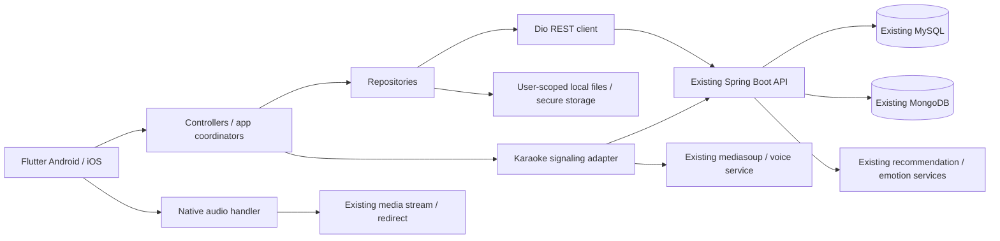

# Kiến trúc Moodify Flutter

Trạng thái: nền app/core/auth và phần lõi M2 home/catalog/search/library/player đã có mã. Những feature còn lại là thiết kế mục tiêu. Đọc `ai/STATE.md` để biết bằng chứng kiểm chứng và áp dụng `AGENTS.md` trước mọi quyết định kỹ thuật.

## 1. Biên hệ thống



Một ứng dụng Flutter độc lập dùng lại backend, các ID, nghiệp vụ và giao thức hiện tại. Không tạo backend riêng, BFF mới hay database mới cho lần chuyển đổi. Kết nối media/realtime qua adapter có vòng đời và allowlist riêng; không để widget tự mở socket hoặc tạo player.

## 2. Stack cơ sở và trách nhiệm

| Thành phần | Lựa chọn | Trách nhiệm |
| --- | --- | --- |
| UI | Flutter / Dart, Material primitives được theme theo Moodify | Android trước để xác minh native karaoke, giữ thiết kế tương thích iOS |
| State và DI | `flutter_riverpod` | Async state của feature, auth và dependency graph; không trộn BLoC/GetX/Provider khác |
| Router | `go_router` | Auth guards, shell 4 tab, detail routes, fullscreen player, deep link thanh toán |
| HTTP | `dio` | Base URL, token, timeout, cancel, error mapping; không gọi HTTP trực tiếp từ widget |
| Audio | `just_audio` + `audio_service` + `audio_session` | Một handler/coordinator quản queue, playback, nền/lock screen/audio focus |
| Token/key | `flutter_secure_storage` | OS-backed storage; không plaintext preferences, không hardcode key |
| File/cache | App-private files, manifest JSON có version | Chỉ thêm package file/path cần thiết khi triển khai offline |
| Karaoke native | Adapter + platform channel/plugin đã xác minh | Pitch capture/voice theo protocol hiện tại; cần spike trước khi chọn package WebRTC/mediasoup |

Nền dùng Riverpod 2.6.1, go_router 17.5.0, Dio 5.11.1, flutter_secure_storage 11.2.0 và uuid 4.6.0 với Flutter 3.41.6 / Dart 3.11.4. Audio M2 dùng just_audio 0.10.6, audio_service 0.18.19, audio_session 0.2.4; API package đối chiếu README/source đã cài. `pubspec.lock` khóa dependency. Không thêm app SQL/ORM; sqflite là dependency gián tiếp của cache trong package, không phải schema nghiệp vụ mới.

## 3. Cấu trúc mục tiêu (tạo dần theo mã thật)

```text
lib/
  main.dart
  app/
    app.dart
    bootstrap.dart
    router/
    theme/
    shell/
  core/
    config/
    network/
    storage/
    errors/
    widgets/
  features/
    auth/
    home/
    catalog/
    search/
    library/
    player/
    profile/
    subscriptions/
    offline/
    karaoke/
test/                    # phản chiếu feature có test thật
integration_test/        # luồng tích hợp có môi trường xác định
assets/brand/            # asset đã chọn, ghi nguồn và quyền tái sử dụng
docs/
android/                 # Flutter CLI sinh khi M1
ios/                     # Flutter CLI sinh khi M1
```

Trong một feature: `presentation/` chứa screen/widget/controller/state; `data/` chứa DTO, repository và remote/local service. Thêm `domain/` khi có mô hình hoặc use-case phức tạp cần độc lập UI/network (đặc biệt queue, entitlement, offline, karaoke). Không bắt mọi CRUD đi qua nhiều lớp trống. Dùng tên `snake_case`; tránh các thư mục mơ hồ `helpers`, `common`, `misc`.

Widget → controller → repository → service. Repository map DTO và hợp nhất nguồn dữ liệu; widget không biết JSON/token/path file. DTO có thể ở data, model dùng chung của catalog ở `features/catalog/domain/`. Các feature khác dùng public model/repository của catalog, không import widget/data internals của nhau. Player và offline giao tiếp qua interface có kiểu trong domain, được wire tại `app/bootstrap.dart`; không phụ thuộc vòng. Shared core chỉ chứa hạ tầng trung lập nghiệp vụ.

## 4. Vòng đời trạng thái

- Auth toàn app: restoring → authenticated/unauthenticated → expired. Logout đổi session generation, hủy request/subscription cũ, dừng player, clear in-memory/user cache và tách quyền truy cập file cũ.
- Feature state: initial/loading/data/empty/error; refresh giữ nội dung cũ nếu còn hợp lệ và cho biết trạng thái. Canceled/stale response không ghi đè query hoặc user mới.
- Auto-dispose screen state phù hợp; giữ auth/playback lâu dài theo app session. Không giữ toàn bộ danh sách vô hạn trong provider. Phân trang/lazy list, bounded image cache, chỉ rebuild phần cần đổi.
- Timestamp có timezone/offset được chuẩn hóa về UTC trong domain, hiển thị theo locale/timezone người dùng. Chuỗi LocalDateTime không timezone (đặc biệt offline) phải xác minh timezone server trước khi quy đổi, không mặc định UTC. Duration typed, đổi ms ↔ seconds ở boundary; không parse mù các ID số/chuỗi.

## 5. HTTP và auth

`API_BASE_URL` là cấu hình public; tách origin/media/voice URL theo contract. Quy ước client base đã bao gồm `/api` và endpoint chỉ nối một lần. Máy thật không gọi localhost của máy phát triển. Không commit IP/LAN/production env riêng vào source.

Bearer token cho API; refresh token POST body theo backend. Đồng bộ refresh đang chạy (single-flight), retry một lần khi 401; login/refresh không đi vào vòng refresh. Không refresh khi 403 bị cấm. Request phải gắn auth generation để retry cũ không đổi user/logout. Refresh thất bại → xóa session và về login. Logout vẫn dọn session cục bộ khi request thu hồi thất bại.

Map envelope và raw response theo endpoint, xem API_CONTRACT. Retry GET có giới hạn/backoff; không tự retry thanh toán, mua gói, ghi lượt nghe hoặc mutation không idempotent. Không log Authorization, token, password, payload thanh toán hoặc query signed/private URL. Chỉ gửi token đến API origin được cấu hình, không chuyển tiếp vô điều kiện qua redirect CDN.

## 6. Playback là một hệ thống dùng chung

`PlaybackCoordinator` nhận play/pause/seek/next/previous từ mini-player, full-player, list và OS controls. Một audio handler duy nhất sở hữu engine. State machine tối thiểu: idle/loading/ready/playing/paused/buffering/completed/error; khả năng thao tác là dữ liệu riêng theo entitlement.

Quy tắc cần test: bài mới bắt đầu 0; resume/retry cùng lượt giữ vị trí; callback cũ không can thiệp bài mới (generation/session ID); queue một bài + repeat off phải dừng; shuffle hữu hạn và Previous theo lịch sử thực tế; restore paused; pause không bị retry tự phát lại. Quy tắc web đã được khảo sát là nguồn hồi quy, không copy code React.

Đường phát chuẩn `/tracks/{id}/stream`, không dùng preview làm bản đầy đủ, không thay nhạc thiếu bằng bài khác. Server có thể trả redirect/range; kiểm tra codec, headers, seek, URL tương đối, audio interruption, Bluetooth, lock screen trên native. Hạn mức/quảng cáo/quality theo server, không suy từ tên gói hoặc bỏ qua khi tải source trực tiếp.

Listening session dùng API telemetry hiện có; chỉ đếm theo event/thời gian thật và đúng đơn vị. Tránh duplicate khi seek/retry/background; logout kết thúc session cũ. Karaoke giành audio focus qua coordinator, dừng/tạm dừng stream thường và khôi phục theo ý định người dùng.

## 7. Lưu tạm và offline

| Loại state | Cách lưu | Giới hạn |
| --- | --- | --- |
| Query, filter, input, queue tạm | RAM, cancel/debounce | Giới hạn số mục, clear theo lifecycle/user |
| Catalog metadata/ảnh từ API thật | Cache TTL/LRU, file nếu cần | Có fetchedAt/version; không coi là quyền dùng hiện tại |
| Token và offline secret | Secure storage theo user | Clear/khóa theo logout, không vào log |
| File nhạc offline | App-private file do client mã hóa, key/license do backend cấp | Manifest theo user, trạng thái tải + expiry/entitlement; không ở Git |
| Payment status | Server | Poll bounded/resume khi quay lại, không suy từ callback/UI |

Không cần tạo bảng server để giữ state giao diện. Cache RAM/JSON cục bộ đủ cho baseline; không tự thêm SQLite tables/ORM. Nếu cần bộ lưu trữ khác thì nêu tradeoff trước. Không phát triển outbox đồng bộ nghiệp vụ tự chế khi chưa có contract idempotency.

Offline RN dùng format file local **MFY1**: backend cấp URL audio/key/license, client tải rồi mã hóa; xem audit về CTR không có authentication tag. Giữ contract API; khi port phải đánh giá tương thích format local, không coi mã hóa hiện tại là DRM hoàn chỉnh. Giải mã theo luồng khi khả thi, đo bộ nhớ và tránh nạp cả bài/base64 vào Dart heap. File tải dở dùng `.part` rồi rename atomically; manifest versioned và recovery khi app bị kill. Không đổi thời gian máy để tự gia hạn; không cho user B dùng file/secret của user A. Thiếu cơ chế kiểm quyền an toàn thì ghi blocker cụ thể cho release offline. App Flutter mới không mặc định đọc được sandbox/file/token Expo cũ; chuyển chức năng không bao gồm nhập dữ liệu local cũ khi chưa có yêu cầu riêng.

## 8. Karaoke và mở rộng

Karaoke chia catalog/detail, solo, room control/signaling, voice/pitch/scoring, recording thành các phần trong **một feature**, không tạo dịch vụ server mới. Trước port toàn bộ UI: spike permission mic, protocol message, đồng bộ clock, voice/WebRTC, pitch frame và audio routing thật. Nếu native iOS chưa có đối ứng, ghi trạng thái riêng; không hạ kết quả Android thành tuyên bố cross-platform đạt.

Trước mở rộng từ web: hoàn tất gate chuyển đổi trong MIGRATION_PLAN. Tính năng mới phải dùng API đã xác minh, reuse repository/model, thêm route có chủ đích. Không tự mở rộng sang dashboard admin/moderator/artist hoặc quản trị nội dung.

## 9. Tài liệu nền đã đối chiếu

Phân lớp View/ViewModel/Repository/Service và domain tùy nhu cầu dựa trên [Flutter architecture guide](https://docs.flutter.dev/app-architecture/guide). Cache/local/remote do repository điều phối theo [Flutter offline-first guidance](https://docs.flutter.dev/app-architecture/design-patterns/offline-first); đây không phải yêu cầu tạo local database.

Khả năng package cần kiểm lại theo phiên bản lúc cài: [Riverpod](https://riverpod.dev/docs/introduction/getting_started), [go_router](https://pub.dev/packages/go_router), [Dio](https://pub.dev/packages/dio), [just_audio](https://pub.dev/packages/just_audio), [audio_service](https://pub.dev/packages/audio_service), [secure storage](https://pub.dev/packages/flutter_secure_storage). Các lựa chọn trong tài liệu là quyết định cho Moodify, không phải toàn bộ đều do Flutter quy định.
